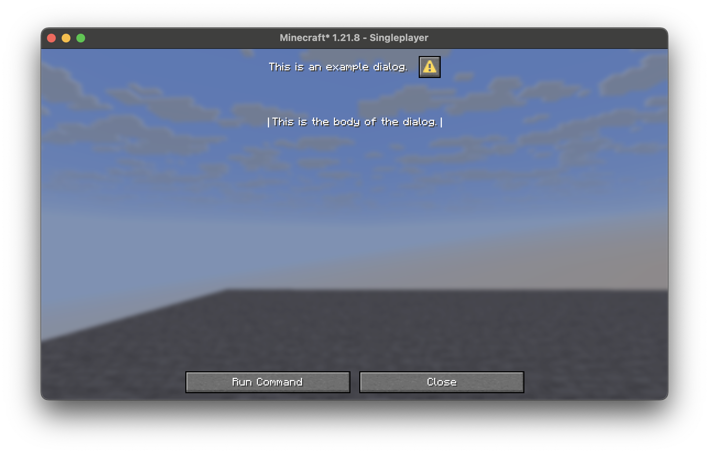
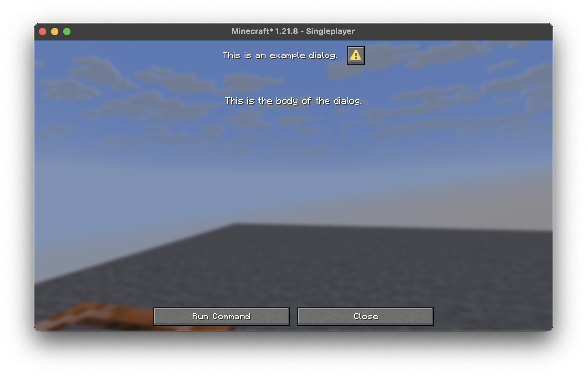
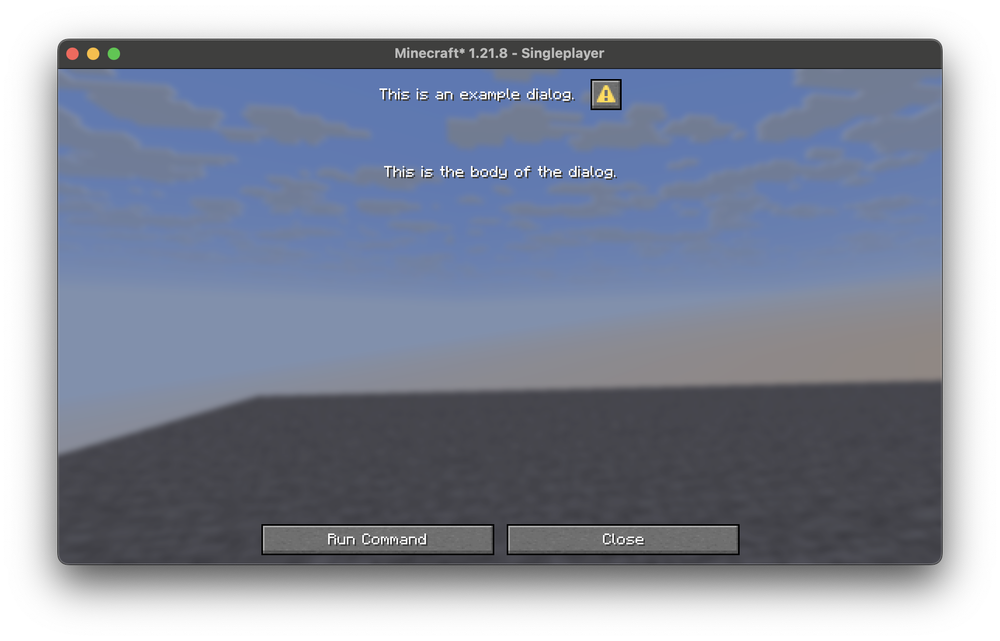
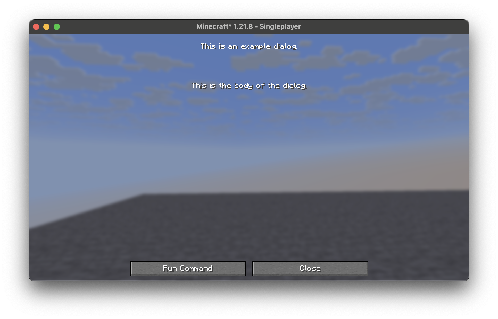
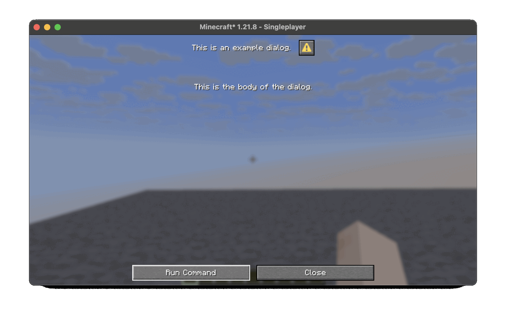

# Unjank


> A set of QoL improvements, designed for datapacks.

## Client-side Features

### Force close a GUI screen
Pressing `Alt+Escape` while in a screen/dialog, will force it to close.

> Access the config via `config/unjank.json` or [Mod Menu](https://modrinth.com/mod/modmenu)


### Disable Focus Border (default = `True`)

Disables the white outline around text elements in dialogs.

> Disable Focus Border = `False`


> Disable Focus Border = `True`


### Disable Warning Box (default = `True`)

Disables the warning box on custom dialogs.

> Disable Warning Box = `False`


> Disable Warning Box = `True`


### Disable Command Warning Screen (default = `True`)

Disables the warning screen when running commands of op-level 1+.

> Disable Command Warning Screen = `False`


> Disable Command Warning Screen = `True`


### Disable Experimental Features Warning Screen (default = `True`)

Disables the warning screen when opening a world that uses experimental features.

## Server-side Features

### Gamerule `unjank:send_trigger_feedback` (default = `sourceAndOps`)

Controls the feedback of the `/trigger` command directly.

Possible values:

`disabled`: No command feedback shown to any player.

`sourceOnly`: Command feedback only show to the player that ran it.

`sourceAndOps`: Command feedback shown to the player that ran it *and* operators.

---

### Gamerule `unjank:broadcast_macro_failure` (default = `false`)

If enabled, macros that fail to be instantiated will be broadcast to *all* operators on the server.

---

### Gamerule `unjank:log_macro_failure` (default = `false`)

If enabled, macros that fail to be instantiated will be logged in the game's output log.

---

### Disabled rate limit for `/trigger`

Unopped players will no longer be kicked for spamming when using `/trigger`.

---

### Custom Creative Mode Tabs

Unjank provides datapacks with the ability of adding items to the creative mode menu. This is done through 2 new resource types:

- **Item Source**: Where to get the item data from
- **Creative Tab**: The display settings for the tab

#### Item Source (`unjank/item_source`)

There are currently 3 source types:

`unjank:item` is a basic item template, same format as a recipe output

```json
{
  "type": "unjank:item",
  "item": {
    "id": "<item_id>",
    "components": {
      <map of components>
    }
  },
  "after": {
    "items": <id/tag/list>,
    "components": {
      <map of components>
    },
    "predicates": {
      <map of predicates>
    }
  },
  "operator": <operator only? true/false>
}
```
**Example**
```json
{
  "type": "unjank:item",
  "item": {
    "id": "minecraft:poisonous_potato",
    "components": {
      "minecraft:item_name": "NOT Poisonous Potato"
    }
  }
}
```
---
`unjank:loot` uses the first output of a loot table

```json
{
  "type": "unjank:loot",
  "loot": "<loot table location>",
  "after": {
    "items": <id/tag/list>,
    "components": {
      <map of components>
    },
    "predicates": {
      <map of predicates>
    }
  },
  "operator": <operator only? true/false>
}
```

**Example:**
```json
{
  "type": "unjank:loot",
  "loot": "namespace:items/my_loot_table"
}
```
---
`unjank:group` allows you to reference multiple item sources

```json
{
  "type": "unjank:group",
  "items": <id/tag/list of item sources>,
  "after": {
    "items": <id/tag/list>,
    "components": {
      <map of components>
    },
    "predicates": {
      <map of predicates>
    }
  },
  "operator": <operator only? true/false>
}
```

**Example:**

```json
{
  "type": "unjank:group",
  "items": [
    {
      "type": "unjank:item",
      "item": {
        "id": "minecraft:poisonous_potato"
      }
    },
    {
      "type": "unjank:loot",
      "loot": "namespace:items/my_loot_table"
    },
    {
      "type": "unjank:group",
      "items": [
        ...
      ]
    }
  ]
}
```

Group's are even more powerful when combined with the following two fields, common to all item sources:

`after` - An item predicate, used to place an item source after another item in the menu (see the section on adding to a vanilla tab)

`operator` - An item only shown to operators
<hr/>
#### Creative Tab (`unjank/creative_tab`)

The creative tab allows you to add a unique tab to the creative mode inventory.

```json
{
  "icon": {
    "id": "minecraft:diamond",
    "components": {}
  },
  "title": "I'm a text component!",
  "items": [
    <item sources>
  ]
}
```

##### Adding to an existing tab

All vanilla tabs can be extended with the following setup:

An item source tab placed at `minecraft:tags/unjank/item_source/<id>.json`, valid ids below:
- `building_blocks`
- `colored_blocks`
- `natural_blocks`
- `functional_blocks`
- `redstone_blocks`
- `tools_and_utilities`
- `combat`
- `food_and_drinks`
- `ingredients`
- `spawn_eggs`
- `op_blocks`

Within that tag you can reference one of your own item sources, ex. 
`minecraft:tags/unjank/item_source/building_blocks.json`
```json
{
  "values": [
    "example:my_source"
  ]
}
```

`example:unjank/item_source/my_source`
```json
{
  "type": "unjank:group",
  "items": [
    {
      "type": "unjank:item",
      "item": {
        "id": "minecraft:poisonous_potato"
      }
    }
  ],
  "after": {
    "items": "minecraft:oak_log"
  }
}
```
